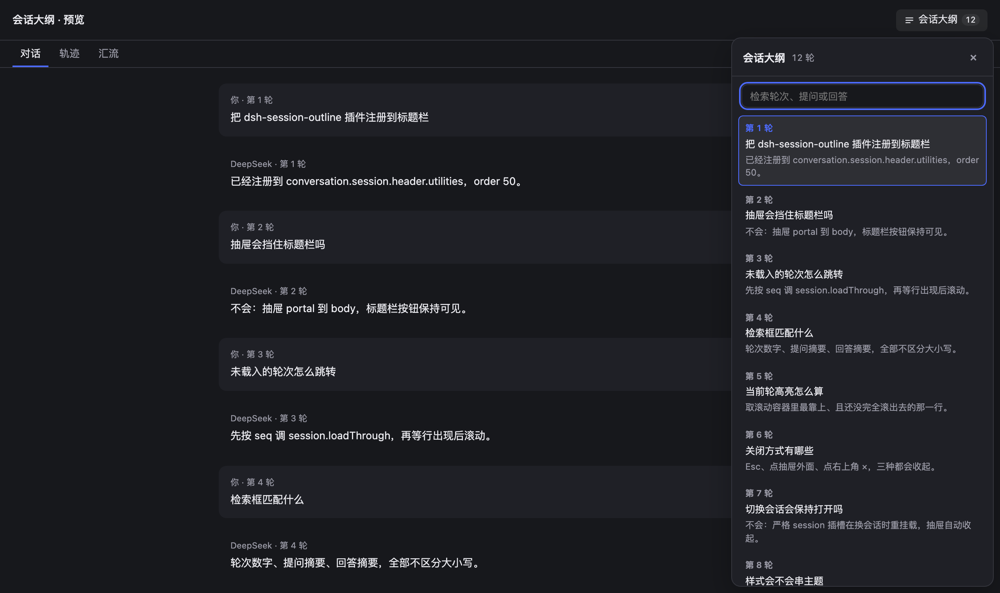
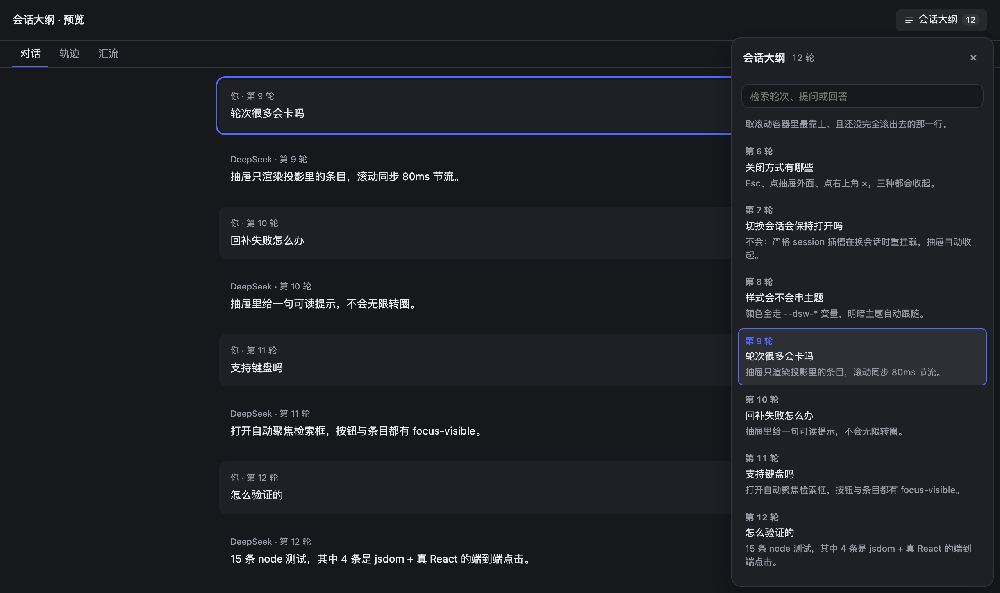

# dsh-session-outline

DSH 插件：给聊天窗口加一个 **本会话大纲**（Session outline）。

会话标题栏右侧多一个「会话大纲」按钮，点开是右侧抽屉：把这个会话的**每一轮**
列出来（第 N 轮 + 提问摘要 + 回答摘要），顶部有检索框，点任意一条就跳到那一轮
并把目标高亮起来——没载入的历史会先按 seq 回补再滚动定位。

- **只读**：不写盘、不联网、不改会话内容。数据全部来自宿主已有的 `turnOutline`
  投影，跳转复用 Chat 视图自己的锚点契约。
- **零依赖**：`lib/client.js` 是手写 classic script（无构建、无 JSX、无 TS），
  React 由宿主作为平台模块注入。

## 界面





| 位置 | 内容 |
|---|---|
| 会话标题栏右侧 | 「会话大纲」按钮 + 轮次计数徽标；再点一次收起 |
| 右侧抽屉 | 标题（轮次数 / 过滤后 x/y）、关闭按钮、检索框、轮次列表 |
| 列表行 | `第 N 轮`、提问摘要（最多 2 行）、回答摘要（最多 2 行）、未载入标记 |
| 当前轮 | 抽屉随阅读位置滚动高亮；点条目跳转后立即高亮 |

交互细节：

- **Esc** 关闭；点抽屉外面也关闭。
- 打开时自动聚焦检索框；检索匹配「轮次数字 / 提问 / 回答」，不区分大小写。
- 切换会话时抽屉自动收起（严格 session 插槽在换会话时重挂载）。
- 目标轮已载入 → 直接滚动；未载入但有 seq → 先 `session.loadThrough(seq)` 回补，
  再在 6s 预算内等这一行出现；等不到就在抽屉里显示「第 N 轮不在当前窗口内，且无法
  回补历史」，不会无限转圈。
- 阅读位置不在「对话」页签时会先切回对话页签，再定位。

## 实现要点

浏览器半边 `lib/client.js` 只注册一个插槽：

```js
ctx.slots.register({ name: 'conversation.session.header.utilities', id: 'session-outline', order: 50 }, OutlineAction)
```

- **数据来源**：标准 session 插槽 props 里的 `useProjection('turnOutline')`
  （宿主包 `@deepseek-ai/dsh-session-turn-outline` 注册的投影，
  条目形状 `{ turn, seq, prompt, response }`，按 turn 升序）。值是 wire 数据，
  归一化时逐字段校验：`turn` 非法丢整行，`seq` 缺失只影响回补，两个摘要降级为 `''`。
- **跳转**：Chat 视图给每个节点包了 `div[data-chat-turn]` / `div[data-chat-anchor-key]`；
  插件按 `data-chat-turn` 找行、滚到滚动容器顶部（留 12px），再打
  `data-outline-landed` 高亮 1.4s。回补走 `ctx.sessions.binding(sessionId).session.loadThrough(seq)`，
  与 Chat 自己的「未载入轮」跳转是同一个 loader。
- **抽屉挂载**：`ReactDOM.createPortal` 到 `document.body`，避免被标题栏的
  `overflow`/层叠上下文裁掉；`react-dom` 不在平台表里时退化为就地渲染，不崩。
- **样式**：注入一个 `style[data-plugin="dsh-session-outline"]`，颜色全部走宿主的
  `--dsw-*` / `--dsw-alias-*` 变量，跟随明暗主题。

Host 半边（`lib/index.js`）是空壳：client-modules 只扫描**已激活**的 Loader 行里的
`dsh.client` 声明，所以这一行必须存在，浏览器半边才会被 serve 出去。

## 工具

无。这个插件不提供模型工具，纯粹是界面。

## 安装 / 卸载

需要 dsh `0.2.2-rc.1` 或更新的 `0.2.x`（见 `package.json` 的 `engines.dsh`）。

### 从 npm

```bash
# 桌面版
dsh plugin --profile desktop add dsh-session-outline

# 纯 Web 版（dsh web）
dsh plugin --profile web add dsh-session-outline
```

### 从 GitHub（无需 npm）

```bash
dsh plugin --profile desktop add github:castiel0101/dsh-session-outline
```

锁定到某个提交：`github:castiel0101/dsh-session-outline#<commit>`

### 从源码（本地开发）

```bash
git clone https://github.com/castiel0101/dsh-session-outline.git
dsh plugin --profile desktop add ./dsh-session-outline
```

### 卸载

```bash
dsh plugin --profile desktop remove dsh-session-outline
```

装完需要**刷新一次页面**：新增的 graph 行只在下次加载时进入 `window.__DSH_BOOT__`
（Host 端 fiber 已 active，无需重启 App）。之后改 `lib/client.js` 不用重装，
宿主 HMR 会重算 rev 并推 `rebuilt` 帧，刷新页面即生效——不用 `pnpm run dev:web`，
因为这里没有客户端构建产物，`lib/client.js` 就是产物本身。

## 兼容性

| dsh 版本 | 状态 |
|---|---|
| `0.2.2-rc.1`（官方桌面版） | 已实测 |
| 其他 `0.2.x` | 未逐一验证；依赖的插槽 / 投影 / DOM 契约在 0.2 线稳定 |

问题请开 <https://github.com/castiel0101/dsh-session-outline/issues>。

## 测试

```bash
node --test test/*.test.mjs
```

- `test/client.test.mjs`：纯函数（归一化 / 检索 / 截断 / 占位符）、插槽注册与
  `loadThrough` 注入、以及用极简 React 替身渲染按钮与抽屉。
- `test/dom.test.mjs`：jsdom + 真 React 18 挂载真实 bundle，真的点按钮开抽屉、
  真的输入过滤、真的点条目并断言滚动位置与高亮；含「未载入轮先回补」和
  「回补失败要有可读提示、不能无限转圈」两条。
